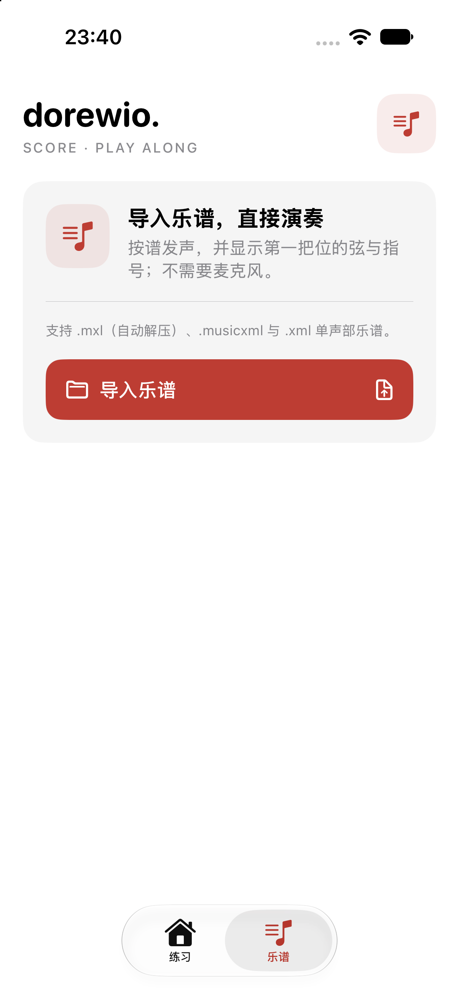

# dorewio.

**Learn music. Play with confidence.**

dorewio. is a native iOS-first violin-learning app built using SwiftUI.

## First lesson / 第一课

For absolute beginners: connect scientific note names (such as **F5**), fixed-do solfège (**Fa**), the four violin strings (**G3, D4, A4, E5**) and actual first-position fingering (**low first finger on E**).

## MVP

- Interactive violin fingerboard, scroll at top and body at bottom
- String and finger selection with immediate feedback
- Eight beginner note exercises
- Reference tone playback (synthesized sine wave, not sampled violin)
- Score workspace: import and play back single-voice MusicXML / MXL with first-position fingering
- iOS 17+, SwiftUI, AVFoundation, no backend or user accounts

## Score workspace / 乐谱

Beyond the starter lesson, the **乐谱** tab imports single-voice sheet music and plays it back so you can follow the score directly:

- Accepts `.musicxml`, `.xml` and compressed `.mxl` (decompressed in memory, no external unzip)
- Shows the first-position string and finger for every note and highlights the note being played
- Play / pause / stop, 0.5×–1.0× tempo, and a measure-range loop
- Optional metronome and one-measure count-in before playback starts
- Notes outside first position still sound but are marked without fingering

Try it with the sample scores in [`Examples/`](Examples/). The parsing, fingering and playback engine live in [`Sources/VibratoCore`](Sources/VibratoCore) and are covered by `swift test` (81 tests).

## Opening the project

Open `dorewio.xcodeproj` on macOS in Xcode 15 or later. Choose an iPhone simulator and run the `dorewio` scheme. On device, select your own Apple Development Team for signing.

**Validation:** Swift source parsed and Xcode project checked for plist syntax in a Linux environment. A macOS build and simulator run have not yet been completed.

## Roadmap

See [docs/ROADMAP.md](docs/ROADMAP.md).

## License

All rights reserved. No open-source license has been granted.